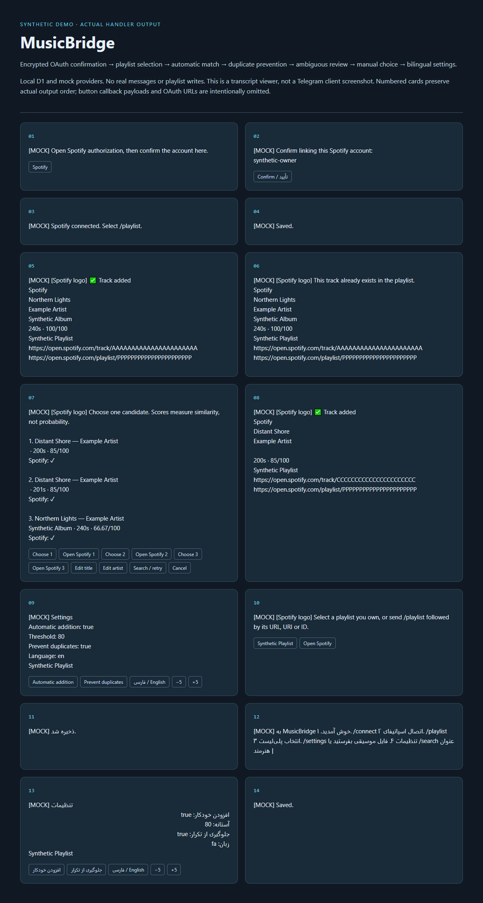
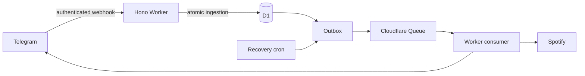

# MusicBridge

An event-driven Telegram-to-Spotify music assistant built with TypeScript, Hono, Cloudflare Workers, D1, and Queues. It turns audio metadata into conservative track matches, with manual review when a recording is uncertain.

**v0.1.0 preview.** Implemented and exercised in a controlled live deployment; unrestricted production acceptance is unresolved. Free-plan HTTP CPU headroom, interactive latency, and burst processing remain concerns. This release is prepared with AI assistance; the owner reviews and accepts engineering responsibility.

[](https://github.com/alirezaaghaeedev/musicbridge/actions/workflows/ci.yml)


Remote CI is pending private staging. Current local verification is recorded in [the release report](docs/public-release-report.md); the badge is not evidence until that run exists.



The image is a rendered transcript of real mock-mode handlers, not a Telegram client screenshot. [Reproduce the demo](docs/demo/README.md).

## Why it exists

Music shared in Telegram often has incomplete titles, filenames, or multilingual artist metadata. Repeating searches manually is tedious; silently choosing a different live recording or remix is worse. MusicBridge searches metadata, ranks recordings deterministically, and asks for review when its safety gates fail. It does not download audio or recognize recordings from sound.

## Implemented capabilities

- English and Persian commands, settings, metadata correction, and playlist selection.
- Spotify OAuth with CSRF protection, Telegram identity confirmation, encrypted tokens, and coordinated refresh.
- Unicode-aware matching with recording-version checks, distinct-recording margins, and bounded computational work.
- Manual candidate review; optional automatic addition with conservative gates.
- Captured submission settings, durable outbox, replay protection, leases, retries, and uncertain-write reconciliation.
- Optional duplicate scan through settings or /duplicates on|off. Disabling it permits existing tracks to be added again; replay protection and uncertain-write reconciliation still apply.
- Credential-free mock providers backed by local D1, unit/integration/security tests, and a synthetic evaluation dataset.

## Architecture



[Architecture and state transitions](docs/architecture.md) · [Engineering case study](docs/engineering-case-study.md) · [ADRs](docs/adr/README.md)

## Matching policy

Extract and normalize metadata, progressively search up to four queries, score title/artist/duration, group equivalent recordings, and compare distinct alternatives. Default automatic gates require score ≥80, title ≥85, artist ≥75, margin ≥8, explicitly playable availability, compatible recording version, enabled automatic addition, and an owned captured destination. A budget limit forces review even for an otherwise perfect match. Similarity scores are not probabilities. [Algorithm and limits](docs/matching.md).

## Local quick start

Install Node.js 22.13 or newer and Git. No provider account, Cloudflare login, or production credentials are needed.

```sh
npm ci
npm run secrets:generate
npm run db:migrate:local
npm run demo:local
npm run dev
```

Open http://127.0.0.1:8787/healthz and /readyz. The demo executes the actual HTTP/Queue handlers against isolated mock providers and local D1. Mock messages are persisted locally rather than sent to Telegram. Generated development keys stay in ignored .dev.vars; generation refuses to overwrite an existing file. Local auto-add defaults OFF; the isolated demo explicitly exercises its synthetic enabled policy.

The build command performs a dry run; none of these commands deploys. Remote operator commands are separate and must only be used after configuring your own accounts. [Developer guide and troubleshooting](docs/development.md).

## Verification

```sh
npm run lint
npm run format:check
npm run typecheck
npm run test:coverage
npm run evaluate
npm run demo:export
npm run docs:check
npm run privacy:check
npm run build
npm audit --audit-level=high
```

Tests cover unit, integration, security, provider contracts, and end-to-end mock flows. [Performance evidence](docs/performance.md) separates local timing, workerd process CPU, and measured Cloudflare invocation CPU. The 64-case synthetic evaluation is not real-world accuracy.

## Security, deployment, and limitations

Webhook bodies are bounded; secrets are compared through fixed-size hashes. OAuth pending tokens are encrypted and bound to a Telegram user, then activated only after that user confirms. Logs omit raw provider bodies and credentials. Database/outbox transactions prevent acknowledged work from disappearing before durable storage. External writes are not exactly-once: uncertain outcomes are reconciled before a retry.

[Deployment](docs/deployment.md) requires your own Spotify developer app, Telegram bot, and Cloudflare resources. Self-hosting grants no access to the original owner's accounts. CI never deploys.

- Free HTTP CPU acceptance remains unresolved: measured samples exceeded the 10 ms allowance. Queue CPU has a different limit.
- Commands and large bursts can be slow; lock contention and exhausted retries have occurred. There is no account-wide provider limiter or qualified 100–500-track import workflow.
- Unknown playability never authorizes automatic selection; manual selection checks the candidate’s availability and may fail closed.
- Duplicate scans are bounded and fail closed; old jobs retain their captured preference.
- Only owned playlists are supported. Metadata is not audio recognition or cross-script transliteration.
- Disconnect removes authorization but is not a complete personal-data erasure mechanism. Operators must resolve deletion obligations before offering a public service.

[Roadmap](docs/roadmap.md) · [Privacy](docs/privacy.md) · [Security reporting](SECURITY.md) · [Contributing](CONTRIBUTING.md)

## License and affiliation

MIT is proposed for original project code, pending owner confirmation of rights and license choice. Spotify's included official logo remains subject to its own terms and is excluded from MIT. [Third-party notices](THIRD_PARTY_NOTICES.md) and [provider compliance](docs/provider-compliance.md) apply. MusicBridge is independent and is not endorsed by Spotify, Telegram, or Cloudflare.
