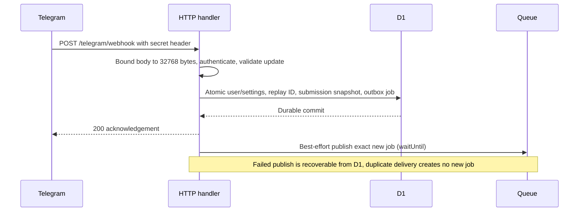
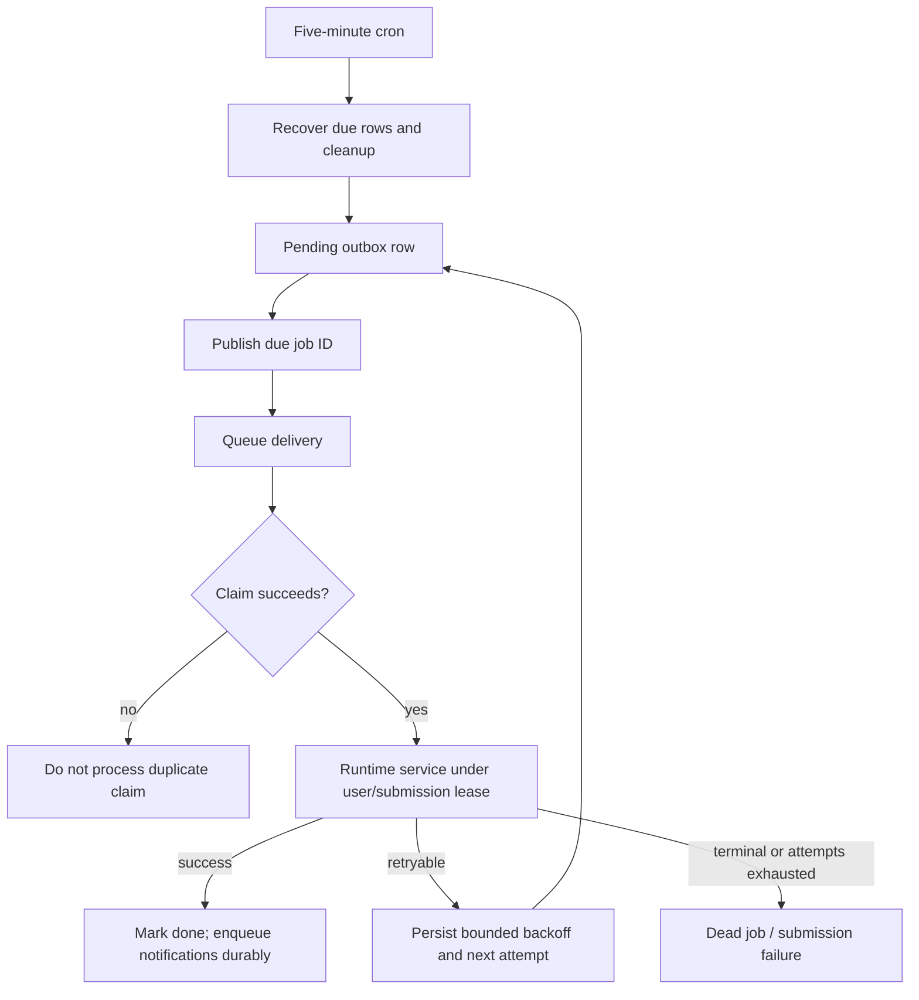
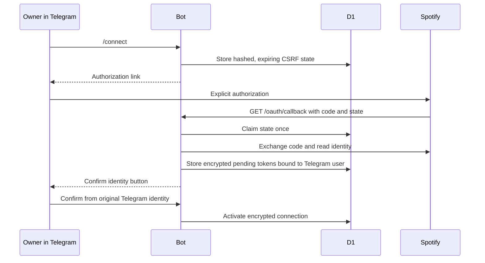
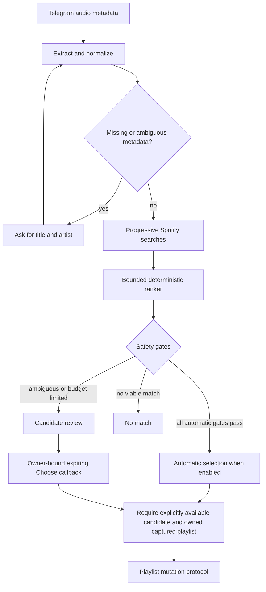
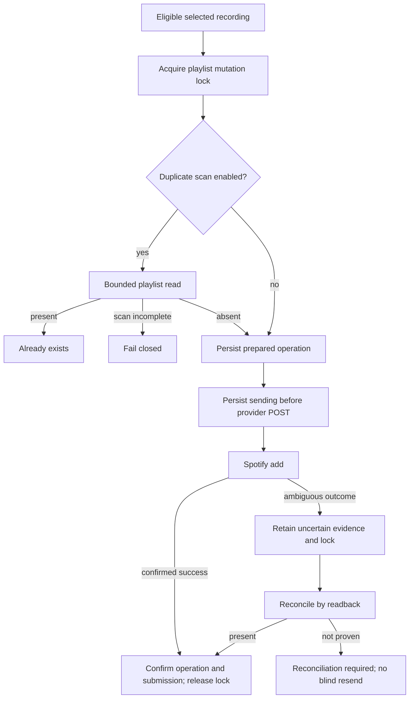

# Architecture

This describes the implemented preview, not a proposed scaling design. Hono routes live in src/index.ts; application orchestration in src/application; persistence/configuration/security in src/infrastructure; pure models in src/domain and scoring in src/matching; provider adapters in src/integrations; bilingual messages and cards in src/presentation.

## Context and components

```mermaid
flowchart TB
  Owner[Telegram user] --> Telegram[Telegram Bot API]
  Telegram --> HTTP[Hono HTTP routes]
  HTTP --> Dispatcher[Dispatcher: validate and ingest]
  Dispatcher --> DB[(D1: state and outbox)]
  Dispatcher --> Queue[Cloudflare Queue: job references]
  Queue --> Runtime[Runtime: claim and process]
  Runtime --> Music[Music and matching]
  Runtime --> Connections[OAuth connections]
  Music --> Spotify[Spotify Web API]
  Connections --> Spotify
  Runtime --> Notify[Telegram notifications]
  Notify --> Telegram
  Cron[Scheduled Dispatcher recovery] --> DB
  Cron --> Queue
```

Domain code does not call providers. Application services enforce decisions and state transitions. Infrastructure supplies transactions, encryption, leases, configuration, and structured logging. Adapters preserve relevant provider codes without persisting raw error bodies. Presentation supplies Persian/English messages and Spotify attribution.

## Telegram ingestion

Processing pause returns 503 after authentication. Private access restricts ingestion to the allowlisted owner. Acknowledgement guarantees durable ingestion, not successful provider delivery.

## Queue, retries, and recovery

Queue messages carry job references; D1 is the source of truth. Application claims have a 15-minute lease and at most five attempts. Queue transport also has its own retry/dead-letter policy. Recovery republishes due work, not a guarantee of eventual success. User/submission and playlist locks serialize unsafe overlaps but can increase latency and exhaust attempts under bursts. There is no global provider-rate scheduler.

## OAuth

State expires after ten minutes. AES-256-GCM protects tokens at rest; it does not protect against a compromised runtime/key. Refresh uses a lease and token version to avoid concurrent replacement. Missing scopes on refresh retain the established scopes. Secrets are configured outside the repository.

## Matching and decision paths

Settings and destination are captured at ingestion. Changing a setting does not silently change an old job. Automatic selection requires more than a high total score; see [matching](matching.md).

## External mutation and reconciliation

D1 cannot atomically commit a Spotify POST. Therefore this is not exactly-once delivery. Presence is evidence that the intended end state exists, not proof of which request created it. Disabling duplicate scanning does not bypass uncertain-write reconciliation. Locks can persist when evidence is unresolved, favoring safety over throughput.

## Trade-offs

D1 makes relational state and atomic ingestion understandable; remote D1 round trips and serialized work consume latency. Queues move heavy work off HTTP but add an asynchronous hop. A durable outbox closes the database/queue gap at the cost of recovery complexity and duplicate deliveries. Deterministic matching is auditable and credential-free in tests but cannot identify unknown audio or resolve every alias. Serverless operation reduces idle infrastructure while exposing strict CPU and provider limits. [ADRs](adr/README.md) record these retrospectively.
